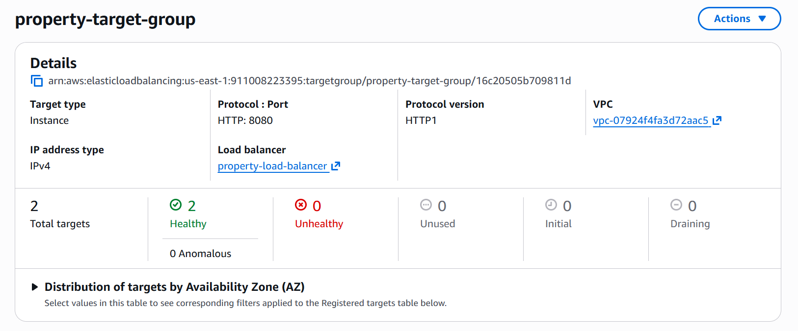
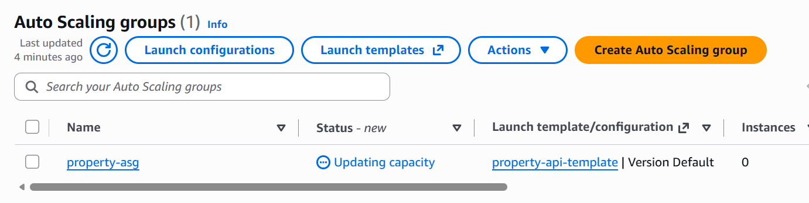
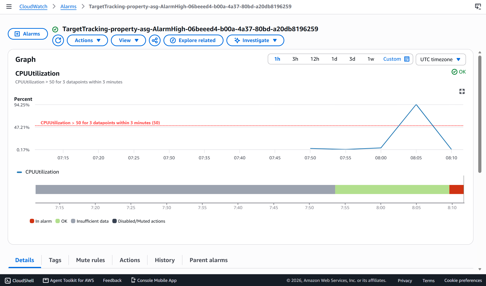
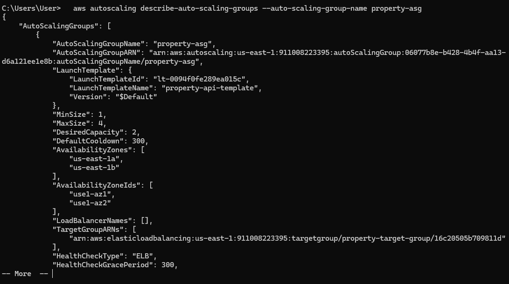

# Week 6 Load Test Report: PropertyLite behind ALB + Auto Scaling

**Date:** 2026-11-02
**Region:** us-east-1
**Author:** Keilani Li

## 1. Architecture

- VPC: `training-vpc` (10.0.0.0/16), 2 AZs, 2 public + 2 private subnets, 1 NAT gateway
- ALB: internet-facing, in both public subnets, listener HTTP:80 → target group (port 8080)
- Auto Scaling Group: `<property-asg>`, private subnets, desired/min/max = 2/1/4
- Launch template: `property-api-template` (Amazon Linux 2023, t3.micro, Flask app on port 8080)
- Scaling policy: target tracking, Average CPU Utilization, target 50%
- Health checks: ELB, path `/health`, grace period 300s

## 2. Deployment verification

| Check | Command | Result |
|---|---|---|
| Health endpoint | `curl http://<alb-dns>/health` | `{"status":"ok"}` |
| Listings endpoint | `curl http://<alb-dns>/properties` | 3 listings returned |

Target group status: 2/2 healthy

## 3. Self-healing test

**Procedure:** Manually terminated instance `<instance-id>` in the EC2 console.

**Result:** Replacement launched in about 2 minutes without manual action.

## 4. Scaling test

**Procedure:** SSH'd through the bastion to a private instance and ran:

    stress --cpu 2 --timeout 300

## 5. Observations

- Any issues you hit and how you fixed them (for example, the security group rule between the ALB and instances, or the user-data base64 checkbox)
    - 502 Bad Gateway

I tried to fix it by adding the correct security groups, but it got confusing and overwhelming. I also realized I didn't launch a bastion instance so I can connect to the private instance through it, and so I mixed up some security groups together. I mainly relied on AI to help me debug without restarting, but I ended up cleaning everything I created and starting over from the beginning, from making the ``training-vpc`` to following steps from both labs for Week 6.

## 6. Lessons learned

- The ALB needs an explicit inbound rule on the instance security group
- Private instances need the NAT route and an explicit subnet association
- ASG self-healing and scaling are automatic once the health checks and policy are configured

## 7. Cleanup

- [X] ASG deleted
- [X] ALB deleted
- [X] Target group deleted
- [X] Launch template deleted
- [X] Bastion terminated
- [X] NAT gateway deleted
- [X] Network interfaces deleted
- [X] EBS volumes/snapshots deleted (if any)
- [X] VPC deleted