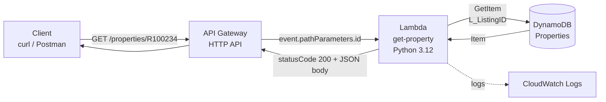

# Week 7: Serverless & Event-Driven Architecture

PropertyLite's read path, re-hosted serverless: **API Gateway → Lambda → DynamoDB**, plus an SQS queue with a dead-letter queue.

Same `get_property` behavior as `propertylite/app.py`, with the CSV read swapped for a DynamoDB read and no always-on compute.

## Contents

| Path | What it is |
|------|------------|
| `lambda_function.py` | The `get-property` Lambda handler |
| `policy.json` | Least-privilege inline policy for the Lambda's execution role |
| `README.md` | This file |

## Request path



1. The client sends `GET /properties/{id}` to the HTTP API's invoke URL.
2. API Gateway matches the route and invokes the Lambda, passing the `{id}` segment as `event['pathParameters']['id']`.
3. The Lambda assumes its **execution role** and calls `GetItem` on the `Properties` table using `L_ListingID` as the key.
4. The Lambda converts the item to JSON and returns it. API Gateway relays it to the client.

## Lab 7.1: API Gateway → Lambda → DynamoDB

### Lambda code

See `lambda_function.py`. One change from the lab's starter code: DynamoDB numbers come back from boto3 as Python `Decimal`, which `json.dumps` can't serialize, so the handler converts them (whole numbers to `int`, the rest to `float`).

### Example response

```bash
curl https://<api-id>.execute-api.us-east-1.amazonaws.com/properties/R100234
```

```json
{"L_SystemPrice": 450000, "L_Keyword2": 3, "L_ListingID": "R100234", "L_City": "Sacramento"}
```

<!-- TODO: paste the real curl output from the deployed API, and compare against PropertyLite's /properties/R100234 on EC2 -->

### Why the Lambda's role only reaches the Properties table

A new Lambda's execution role can only write logs. To let it read data, I attached an inline policy (`policy.json`) that allows a single action, `dynamodb:GetItem`, on a single resource, `arn:aws:dynamodb:*:*:table/Properties`.

This is least privilege, the same pattern as Week 2:

- **Action is scoped to what the code calls.** The handler only does `get_item`, so it can't scan, write, or delete.
- **Resource is scoped to one table.** If the function is compromised or has a bug, it can't read any other table in the account.
- **Compared to `AmazonDynamoDBReadOnlyAccess`:** that managed policy grants read access to every table in the account, which is far more than this function needs.

### Debugging notes

Issues hit while building this, and how each was diagnosed (always from CloudWatch logs, not from the API response):

| Error | Meaning | Resolution |
|-------|---------|------------|
| `ResourceNotFoundException` on `GetItem` | The permission check passed, but DynamoDB couldn't find the requested table | Forgot to create the DyanamoDB table, follow the instuctions from Week 4 |
| `TypeError: Object of type Decimal is not JSON serializable` | boto3 returns DynamoDB numbers as `Decimal`; `json.dumps` can't encode them | Added a `default=` converter to `json.dumps` |

Other failures to watch for (from Debug Lab 7.3):

- `AccessDeniedException`: the policy's table ARN doesn't match the real table name (for example `Property` vs `Properties`).
- `KeyError: 'pathParameters'` or `'id'`: the route was deployed as `/properties` instead of `/properties/{id}`.
- `{"message": "Internal Server Error"}` from API Gateway only says the Lambda failed. The cause is in **Lambda → Monitor → View CloudWatch logs**.

## Lab 7.2: SQS with a dead-letter queue

```bash
### in powershell
aws sqs create-queue --queue-name property-dlq

# create json file
@'
{
  "RedrivePolicy": "{\"deadLetterTargetArn\":\"arn:aws:sqs:us-east-1:911008223395:property-dlq\",\"maxReceiveCount\":\"3\"}"
}
'@ | Set-Content -Encoding ascii attributes.json

# create sqs queue using json file
aws sqs create-queue --queue-name property-queue --attributes file://attributes.json

# verify, should see property-dlq and property-queue after this
aws sqs list-queues


# verify redrive policy
aws sqs get-queue-attributes --queue-url https://sqs.us-east-1.amazonaws.com/911008223395/property-queue --attribute-names RedrivePolicy


aws sqs send-message --queue-url <property-queue-url> --message-body '{"PropertyId":"P1002"}'
aws sqs receive-message --queue-url <property-queue-url>
```

**Result:** `receive-message` returned the JSON body that was sent. <!-- TODO: confirm -->

## Serverless vs. EC2 (takeaways)

| | EC2 (Week 1-4) | Lambda + API Gateway |
|---|---|---|
| Compute | Always on, billed while running | Runs per request, billed per ms |
| Scaling | Manual or via Auto Scaling | Automatic per request |
| Idle cost | Yes | Effectively none |
| Latency | Consistent | Cold start on first request after idle |
| Ops burden | OS patching, process management | None for the runtime |